# Getting started

## What the app does

The app combines two files you already have:

- a **GPS track** (`.gpx`, e.g. exported from Strava): *where* you were;
- an **air-quality sensor log** (`.csv`, e.g. from a ParticularMatter / KongQi node): *what* the sensor measured.

It matches them **by time** and shows:

1. a **map of your route coloured by pollution level**;
2. a **time series** of the readings;
3. a **CSV download** with position + measurements for every reading.

## Step 0: Install and start the app

Install R ≥ 4.1 and, once, the packages:

```r
install.packages(c("shiny", "bslib", "leaflet",
                   "plotly", "xml2", "readr",
                   "dplyr", "lubridate", "tibble"))
```

Start the app in one of these ways:

- **RStudio:** open `particularmatter-gpx.Rproj`, open `app.R`, click **Run App**;
- **R console:** `shiny::runApp()`;
- **Terminal:** `Rscript -e 'shiny::runApp(launch.browser = TRUE)'`.

The app opens in your browser. An internet connection is needed for map tiles and fonts.

## The app when it opens

:::: {.columns}
::: {.column width="62%"}
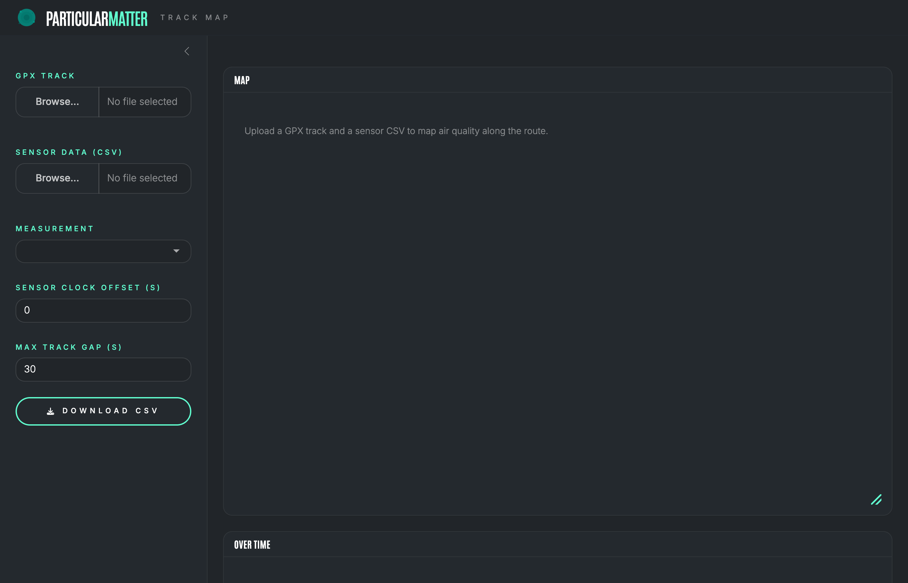{height=72%}
:::
::: {.column width="38%"}
\small

- **Sidebar (left):** files and settings.
- **Map** and **Over time** cards (right) fill in once files are loaded.
- Until then the map shows a hint: *Upload a GPX track and a sensor CSV…*

To try the app without your own data, use the demo files in `example/`.
:::
::::

# Step by step

## Step 1: Upload the GPX track

:::: {.columns}
::: {.column width="30%"}
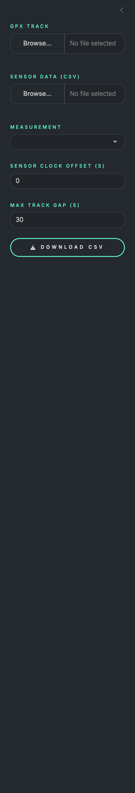{height=78%}
:::
::: {.column width="70%"}
\small

Click **Browse…** under **GPX track** and choose your `.gpx` file.

**From Strava:** open the activity on the website, click the **three dots** menu, then **Export GPX**.
Any GPX file with timestamps works (Garmin, Komoot, phone apps…).

Demo: `example/demo_track.gpx`.
:::
::::

## Step 1: The track appears on the map

```{=latex}
\begin{center}
```

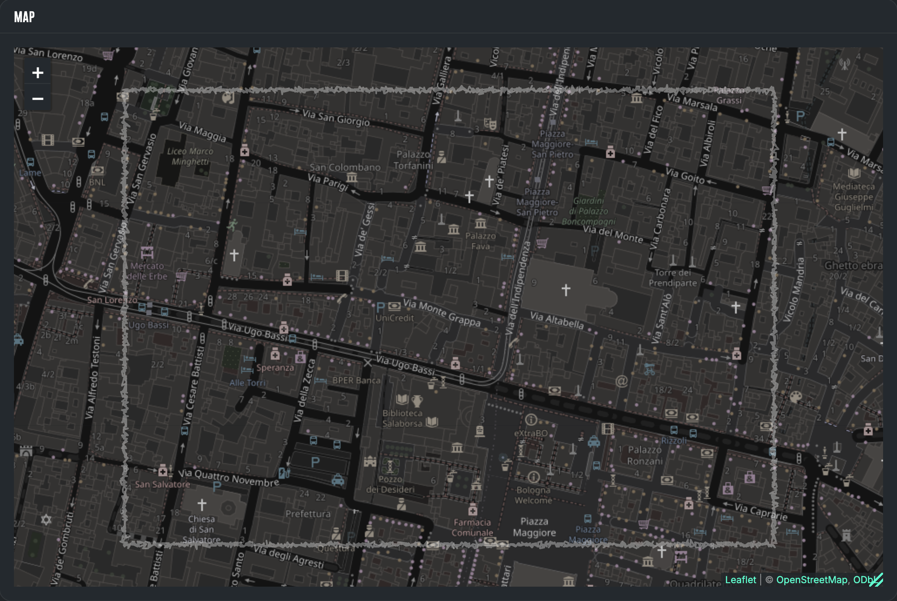{height=72%}

```{=latex}
\end{center}
```

\small

The route is drawn as a faint white line. There are no coloured dots yet: they need the sensor file.

## Step 2: Upload the sensor CSV

:::: {.columns}
::: {.column width="62%"}
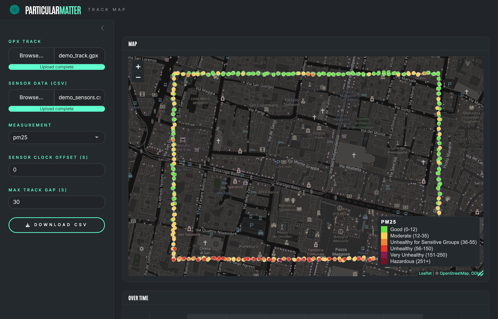{height=72%}
:::
::: {.column width="38%"}
\small

Click **Browse…** under **Sensor data (CSV)**.
For a KongQi node, this is the log file copied from the SD card.

Demo: `example/demo_sensors.csv`.

Each dot is now **one sensor reading**, placed where you were at that moment and **coloured by its air-quality band**.
:::
::::

## Step 3: Choose a measurement

:::: {.columns}
::: {.column width="30%"}
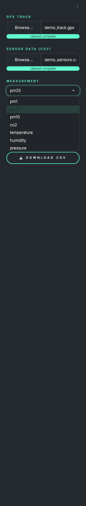{height=78%}
:::
::: {.column width="70%"}
\small

Open **Measurement** and pick what to map: `pm1`, `pm25`, `pm10`, `co2`, `temperature`, `humidity`, `pressure`, …

Any numeric column in your CSV shows up in this list.

PM2.5 is selected by default when it is present.
Map, legend and chart update immediately.
:::
::::

## Step 3: The same route, PM10

```{=latex}
\begin{center}
```

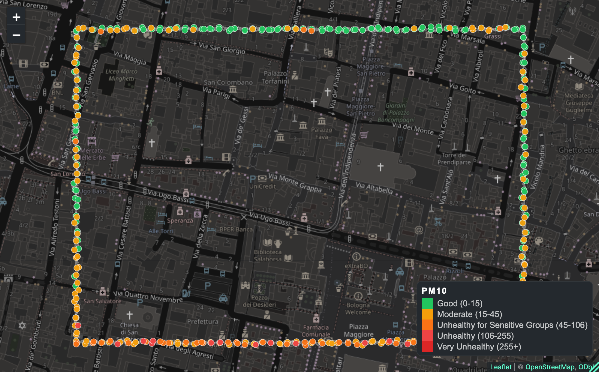{height=72%}

```{=latex}
\end{center}
```

\small

Changing the measurement re-colours the dots and the legend (here PM10, with its own bands).

## Step 4: Read the map

```{=latex}
\begin{center}
```

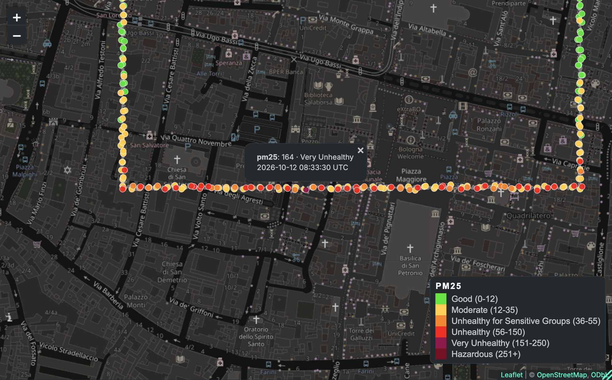{height=72%}

```{=latex}
\end{center}
```

\small

Click a dot to see its value, band and time. Hover to see just the value. Use + / − or the mouse wheel to zoom.

## Step 4: How many readings were matched?

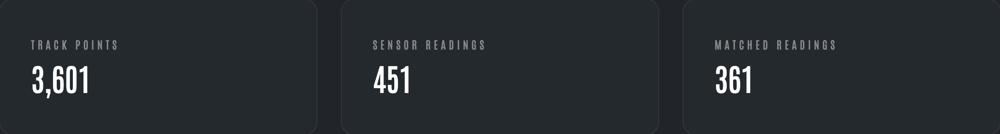{width=100%}

\small

Below the chart, three boxes summarise the data:

- **Track points:** points in the GPX file;
- **Sensor readings:** rows in the CSV;
- **Matched readings:** readings that fell **inside the track's time range** and were placed on the map.

Readings taken before the track starts or after it ends are not mapped (here, the sensor ran 5 min before and 10 min after the walk).

## Step 5: Check the time series

```{=latex}
\begin{center}
```

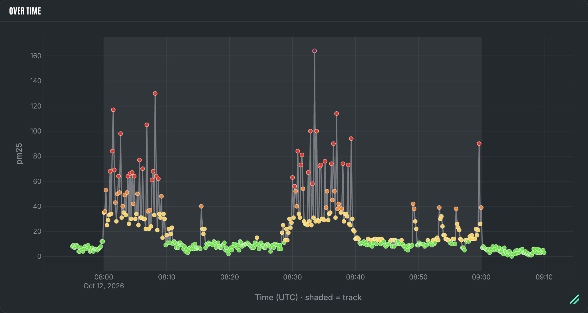{height=68%}

```{=latex}
\end{center}
```

\small

All sensor readings over time, in the same colours as the map. The lighter shaded area is the period covered by the GPS track. Hover for exact values.

## Step 6: Download the combined data

:::: {.columns}
::: {.column width="35%"}
{width=100%}
:::
::: {.column width="65%"}
\small

Click **Download CSV**. You get `<track name>_air_quality.csv` with one row per matched reading:

| Column | Meaning |
|---|---|
| `time` | Reading time (UTC, offset applied) |
| `lat`, `lon`, `ele` | Position from the GPX track |
| `pm25`, `co2`, … | All measurements |
| `time_source` | `gps`, `wifi` or `ts_ms` |
:::
::::

# Fine-tuning

## Sensor clock offset

If the sensor clock was wrong by a known amount, enter the correction in **Sensor clock offset (s)**:

- a **positive** value moves the sensor data **later**;
- a **negative** value moves it **earlier**.

Example: the sensor clock was 2 minutes slow → enter `120`.

Map, chart and summary update immediately. Use the warnings on the next slides to check the result.

## Warning: partial overlap

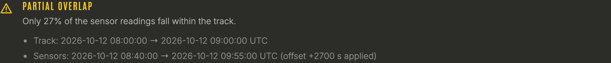{width=100%}

\small

A **yellow** banner appears above the map when **fewer than half** of the sensor readings fall within the track.
It lists both time ranges so you can compare them.

**What to do:** check that the sensor clock was set correctly, and correct it with the clock offset if needed.

## Warning: no time overlap

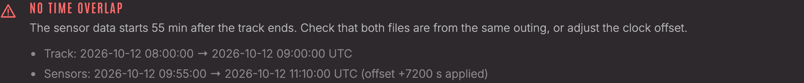{width=100%}

\small

A **red** banner means the two files **share no time at all**. The map shows only the grey track.
The banner says how far apart the two files are.

**What to do:** make sure both files are from the **same outing**. If they are, the sensor clock is wrong: set the clock offset.

## Max track gap and resizing

**Max track gap (s)**, default 30 s.
If the GPS recording paused (e.g. a stop at a café), readings taken during the gap are **dropped** rather than placed on a straight line between the two ends of the gap.
Increase it if your GPS records points only rarely.

**Resize the map or chart.**

- Drag the **teal handle** in the bottom-right corner of a card.
- Or use the **full-screen** button in the card's corner.

# Reference

## Colour bands

\small

| Level | PM2.5 / PM1 (µg/m³) | PM10 (µg/m³) |
|---|---|---|
| Good | 0 – 12 | 0 – 15 |
| Moderate | 12.1 – 35.4 | 15.1 – 45 |
| Unhealthy for Sensitive Groups | 35.5 – 55.4 | 45.1 – 106 |
| Unhealthy | 55.5 – 150.4 | 106.1 – 255 |
| Very Unhealthy | 150.5 – 250.4 | 255.1 + |
| Hazardous | 250.5 + | – |

- **CO₂ (ppm):** Good ≤ 800 · Moderate ≤ 1000 · Poor ≤ 1500 · Very Poor > 1500
- **Temperature, humidity, pressure:** comfort bands, shown in the legend
- **Any other column:** a teal scale from dim (low) to bright (high)

## Sensor CSV format

\small

One row per reading, with a header row. All times are in **UTC**.

| Column | Needed? | Meaning |
|---|---|---|
| `gps_datetime` | one of the two | GPS time, e.g. `2026-10-12T08:05:10Z` |
| `wifi_datetime` | one of the two | Internet time, used if GPS time is missing |
| `ts_ms` | optional | ms since start; fills in missing times |
| `pm25`, `co2`, … | at least one | Measurements (any numeric column) |
| `lat`, `lng`, … | optional | Ignored: the GPX gives the position |

## Troubleshooting

\small

| Problem | What to do |
|---|---|
| Red **No time overlap** banner | Use files from the same outing, or set the clock offset |
| Only a grey line, no dots | No readings in the track's time range; read the banner |
| Map tiles or fonts missing | Connect to the internet |
| "Could not read GPX" | The GPX needs `<trkpt>` points with `<time>`; re-export it |
| "Could not read sensor CSV" | Add a `gps_datetime` and/or `wifi_datetime` column |
| Upload rejected as too large | The limit is 100 MB; change `shiny.maxRequestSize` in `app.R` |
| `there is no package called …` | Install the missing package |

## Summary

1. **Start** the app: `shiny::runApp()`.
2. **Upload** the GPX track.
3. **Upload** the sensor CSV.
4. **Choose** a measurement.
5. **Read** the map: click dots, check the matched count.
6. **Check** the time series and any overlap warning; fix the clock offset if needed.
7. **Download** the combined CSV.
